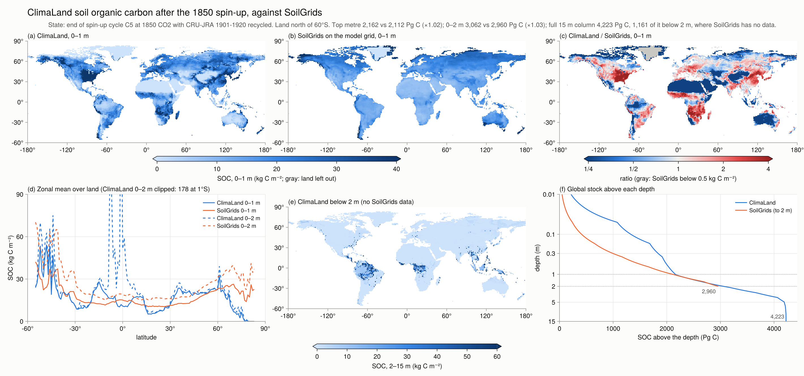

# Spun-up 1850 initial conditions for ClimaLand with carbon pools

This artifact holds the full state of the ClimaLand `LandModel` at the end of a spin-up
at the 1850 CO2 level, with prognostic LAI (`ZhouOptimalLAIModel`), carbon pools
(`PrognosticCarbonModel`) and soil organic carbon (SOC) fed by the pools' litter. It is
the initial condition of TRENDY-style transient runs that start in 1850 (S0, S1 and S2
over 1850–2023).

## Contents

`climaland_1850_spunup_ic.nc` (19.7 MiB), on the 1° longitude–latitude grid of
`ClimaLand.Domains.global_box_domain` (360 × 180 columns, 15 soil layers to 15 m):

- one variable for each field of the model state `Y`, in Float64, named after its path
  (`soil.ϑ_l` is `soil_vartheta_l`, `soilco2.SOC` is `soilco2_SOC`); the attribute
  `climaland_field` gives the path. Subsurface fields are on (lon, lat, z), surface
  fields on (lon, lat), and `canopy.photosynthesis.acclimated` on (lon, lat, component);
- `lon`, `lat` (cell centres, degrees) and `z` (layer centres, m, negative below the
  surface), and `land_mask` (1 where the model's land mask, threshold 0.99, is active).

Every column is written, including those the land mask leaves out, so that the file
reproduces the state exactly: the conversion reads the file back and compares every value
with the state.

## How it was made

The state comes from the spin-up recorded on the ClimaLand branch
[`ar/trendy_spinup_1850`](https://github.com/CliMA/ClimaLand.jl/tree/ar/trendy_spinup_1850)
at commit `772d7135f`, where `experiments/trendy_spinup_1850/README.md`
lists the code, the configuration and the steps:

- ClimaLand main at b7829b5fc, with two options of the CRU-JRA forcing (fill of missing
  values, zenith-scaled shortwave);
- CRU JRA v2.5 forcing with the 1901–1920 cycle recycled, and CO2 fixed at its 1850
  annual mean (286.8 ppm, Law Dome);
- main's default parameters, except `soilCO2_reference_rate` = 6.7e-7 kg C m⁻³ s⁻¹ and
  `michaelis_constant` = 0.70 kg C m⁻³ (proposed as defaults in CliMA/ClimaLand.jl#1968);
- five 20-year cycles (C1–C5, about 100 simulated years on one A100) with the vegetation
  pools set to their equilibrium after each, and two offline solves of the SOC steady
  state on per-layer respiration curves; the state is the end of C5 (`spun_1909.hdf5`).

To make the artifact from that state:

```
bash make_state_netcdf.sh <path to spun_1909.hdf5>
```

It checks out the commit above, writes the NetCDF file and the figure with
`state_to_netcdf.jl` and `soc_spinup_figure.jl`, and calls `create_artifacts.jl`.
Created with Julia 1.13.3.

## Soil carbon against SoilGrids



Land north of 60°S, SoilGrids as ClimaLand reads it (`soilgrids_ocd_lowres_interp` on the
model's layers and land points):

| Pg C | 0–1 m | SoilGrids | 0–2 m | SoilGrids | full column |
|---|---|---|---|---|---|
| global | 2,162 | 2,112 | 3,062 | 2,960 | 4,223 |
| north of 50°N | 597 | 724 | 665 | 1,008 | 695 |
| 30–50°N | 631 | 439 | 693 | 590 | 807 |
| 30°S–30°N | 819 | 815 | 1,576 | 1,136 | 2,588 |
| 60–30°S | 115 | 134 | 129 | 226 | 133 |

## Caveats

- The state is not in equilibrium everywhere. Over the last 20-year cycle, the global NBP
  is 2.14 Pg C/yr with no trend: SOC rises by 0.3 Pg C/yr in the top metre and by
  1.76 Pg C/yr below 1 m, almost all of it in tropical layers at 1–4 m, where root litter
  enters faster than respiration, limited by its saturated rate and by O2, removes it.
  The column drift is below 10 g C m⁻² yr⁻¹ on 85% of the land (97% north of 50°N, 74% in
  the tropics). Transient runs should subtract a control run (S0) from the same state.
- The global totals match SoilGrids, but by compensation: the boreal zone lacks about a
  third of SoilGrids' 0–2 m carbon, while the tropics hold 40% more over 0–2 m and
  another 1,000 Pg C below 2 m, where SoilGrids has no data. The vertical profile is
  shallower than SoilGrids' (about 1,600 Pg C in the top 10 cm against about 500).
- The state belongs to this configuration: the 1° box domain with 15 layers, the
  parameters above and CRU-JRA forcing. With other parameters, forcing or resolution it
  is a starting point that needs its own spin-up.
